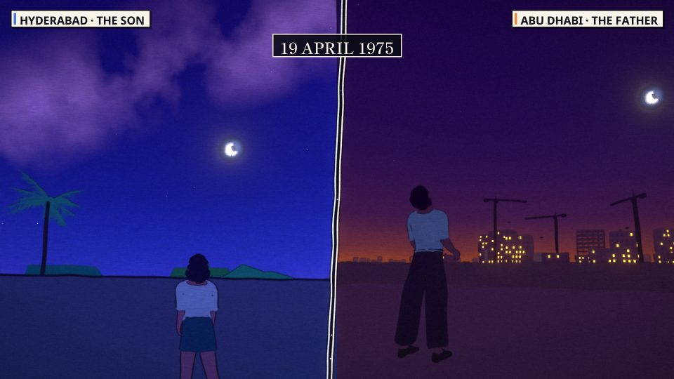
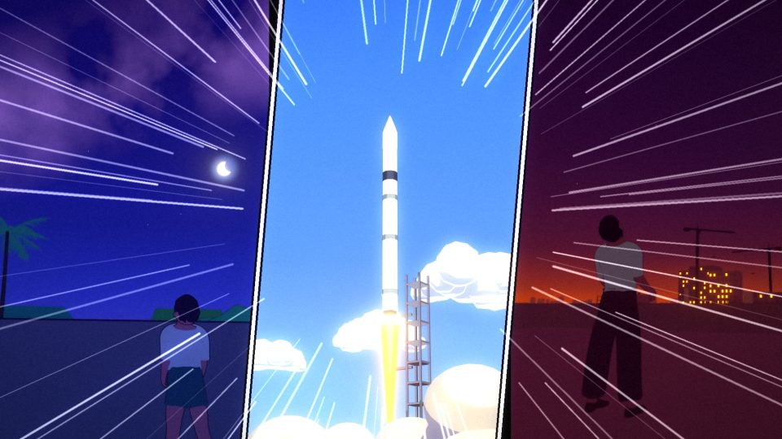
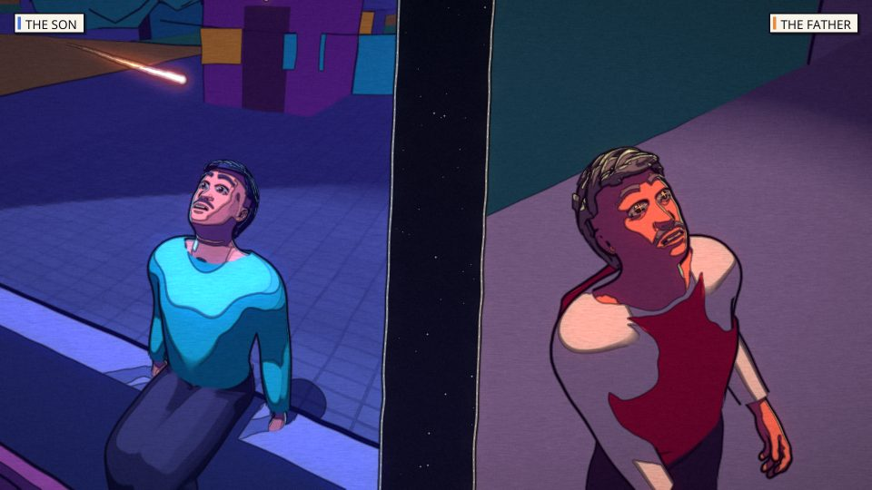
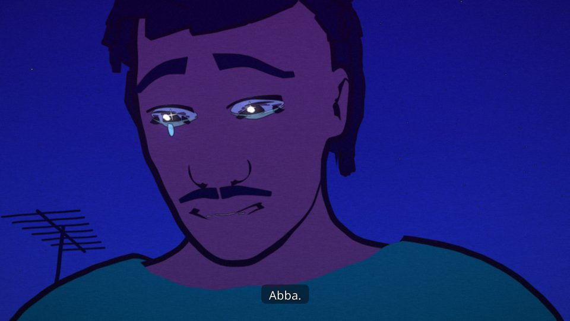

# ALWAYS FALLING

A 5-minute anime-style short film for the **DADC Short Film Festival 2026** (IIT Delhi Abu Dhabi), theme **GRAVITY**, by Team FirstCommit.

> Hyderabad, 1975. The week India launches its first satellite, Aryabhata, a father leaves for the building sites of
> Abu Dhabi. On their last night on the rooftop he tells his son that a satellite is *always falling toward the Earth,
> but moves so fast that it keeps missing*, and promises that every night when it passes they will both look up.
> The satellite goes silent after four days but keeps circling for seventeen years, the only thing that crosses
> between two drifting lives, until in February 1992 it finally falls home.

| | |
|---|---|
|  |  |

## How it is made

Everything is generated from code: Blender 5.1 (EEVEE) scenes built and rendered by Python scripts, a Python
compositor, and a soundtrack assembled in code from recorded instruments, field recordings and synthesis.

- **Characters:** MPFB/MakeHuman base meshes (CC0) with scripted garments, hair and anime eyes. `film/lib/face.py` is
  a facial-expression engine with brows, lids, mouth via face bones, blinks, lip-sync from the voice clips, tears and eye
  sparkles. `film/lib/acting.py` is the acting sheet that keys every expression to its story beat.
- **Sets:** procedural Hyderabad Old City (Charminar skyline), 1970s Abu Dhabi construction sites, the Kosmos-3M
  launch, Earth from orbit (NASA Blue/Black Marble, posterised in the shader), a 92,000-orbit "cocoon" and the
  re-entry plasma (`film/lib/sets_*.py`, `film/lib/scene_*.py`).
- **Shots:** one build + render script per shot in `film/shots/`. The split-screen halves live in `film/shots/half.py`.
- **Anime look:** cel ramps with soft edges, inverted-hull ink outlines and animation on twos. In post
  (`film/post/edit.py`): impact frames, manga focus lines, a panel-slam montage, speed lines, light sweeps for time
  jumps, god rays, ink edges and paper grain, plus the burning fragments of Aryabhata in the last shot.
- **Life and set passes (V3):** `film/lib/life.py` adds breathing, idle motion, a handheld camera, swaying trees and
  depth of field on close-ups; `film/lib/detail.py` paints variation and contact shadows into every set surface and
  chamfers box edges, against the blockout look.
- **Split-screen grammar:** Hyderabad (the son) on the left and Abu Dhabi (the father) on the right, as two slanted manga
  panels on a starry gap that widens over the years. Only the satellite crosses it, until re-entry burns it away.
- **Sound** (`film/post/audio.py`): an original cue sheet played by recorded instruments (`film/post/sampler.py`:
  upright piano for the "promise" motif, string sections, glockenspiel, orchestral bass drum) over a synthesised
  tanpura drone. Ambiences and foley are CC0 field recordings (`film/post/sfx.py`, fetched by `film/post/fetch_sfx.py`
  with an attribution manifest), each matched in loudness to the cue it replaces. The stereo field follows the split.
- **Voices** (`film/post/vo_edge.py`): Hindi/Urdu dialogue and English radio from neural TTS, built phrase by phrase
  inside each subtitle window; the lip-sync is baked from the same clips at render time.
- **Timeline** (`film/post/timeline.py`): the master edit (7,200 frames at 24 fps), subtitles, captions and voice placement.

Run a shot: `blender -b --factory-startup -P film/shots/half.py -- preset=J2 final`
Assemble: `python film/post/audio.py && python film/post/edit.py --audio film/audio/mix.wav --out film/final/film.mp4`

Rendered frames, videos, `.blend` files and downloaded assets are not committed (see `.gitignore`).

## Third-party assets (free licences)
- Earth maps: NASA Blue Marble / Black Marble (public domain), via Wikimedia Commons
- Human base meshes: MPFB / MakeHuman (CC0)
- Fonts (SIL Open Font License): IBM Plex Mono, Shippori Mincho, Noto Sans
- Instruments: VS Chamber Orchestra 2: Community Edition (CC0, Versilian Studios; upright piano by Simon Dalzell / Ivy Audio)
- Sound effects: CC0 recordings from Freesound; titles, authors and links in `film/assets/dl/sfx/manifest.json`
  (regenerate with `python film/post/fetch_sfx.py`)
- Voices: Microsoft neural TTS (V3); V1-V2 used Piper models ("rohan", IIT Madras IndicTTS; "pratham"; "alan")

## AI use (declared, as required by the festival)
- **Concept and script:** developed with Claude (Anthropic), ChatGPT (OpenAI) and Gemini (Google) as brainstorming and
  critique partners. The team chose the story, setting, language and creative direction.
- **Production code:** scene, character, animation, facial-expression, compositing and audio scripts written by Claude
  (an AI coding assistant) under the team's direction. All frames are rendered locally from these 3D scenes.
- **Voices:** AI text-to-speech: Microsoft neural voices (hi-IN Madhur, ur-IN Salman, hi-IN Swara, en-IN Prabhat).
  Earlier versions used Piper.
- **Not used:** no generative image or video model created any frame.

The family is fictional. Aryabhata's history is real: launched 19 April 1975, power failure after four days,
mainframe signals until March 1981, re-entry in February 1992. The re-entry being visible over Hyderabad is
poetic licence.

## Versions

- **V1:** first full cut.
- **V2:** after team feedback ("who is on the left?", "picture moving, not animation", "eyes look like crying"):
  manga-panel split with place/person captions, hand-drawn ink, corrected staging (legs through furniture, crossed
  arms, the door knock), clear eyes by default and closed eyes in sleep.
- **V3:** after team feedback on V2 ("low poly", "bad sound", "SFX", "the ending is not understandable", "watery"):
  recorded instruments and real sound effects, natural Hindi/Urdu voices, the set detail pass, the life pass, the
  line-boil wobble removed, and an ending you can follow: All India Radio announcing Aryabhata's return, the father
  shown home in the lane, a readable reveal from the lane up to the roof, "Beta... I'm home", and the promise
  paid off: "Every night... I looked up." / "So did I, Abba."
- **V4:** after "it still feels like a picture moving", "more drawing", "more impact frames": parallax camera moves on
  every shot (ray-cast against the set and checked so no character leaves the frame), voice-driven head and hand
  gestures for whoever speaks, the father's walk home up the lane, kites over the Old City, anime line art traced
  from every frame, painted wide shots (Kuwahara), impact frames on every big beat, meteors, and a reframed reveal.
- **V5:** after the V4 audit (the son was still a speck in the reveal): the reveal re-cut as the father's point of
  view, a long lens straight up the wall at his son gripping the parapet while burning pieces of the satellite cross
  the sky above him; the reveal's focus finally lands on the son (a duplicated settings key had dropped it); people
  glance aside and back in the calm shots of the 1975-1992 montage.
- **V6:** for phone screens and a living background: subtitles and mission-log text enlarged, a gentle lift on the
  night grade so faces and rooftops read on a phone (hue and black/white points kept), the Abu Dhabi cranes swing
  through every skyline shot with blinking warning lights, and in 1980 the father covers his eyes after his own
  taped "look after Ammi". Submitted as AlwaysFalling_MohammadUmar.mp4.
